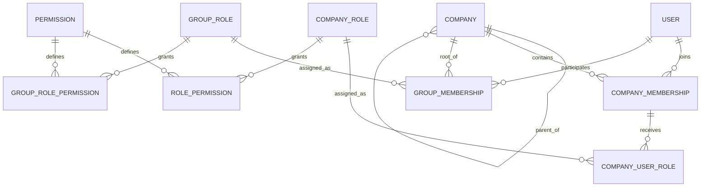

# Hierarchical multi-tenant architecture

This implementation extends the existing FegHR tenant model. It keeps all historical company
IDs, slugs, employees, attendance, leave and licences. It does not create demo Group Admins or
enable a new approval policy automatically. The Product Owner chooses these explicitly.

## Company model and relational schema

`platform.Tenants` is the company table. A root ID also serves as the group ID; there is no
duplicate group/company identity. `ParentTenantRefId NULL` represents an independent company
or a holding company with zero concerns. Attaching concerns or assigning a group role gives
that root a holding-company function. Each subsidiary has exactly one non-null parent.
Only one parent/child level is supported; employee reporting lines are a separate hierarchy.

| Table | Key / relationships | Purpose |
|---|---|---|
| platform.Tenants | Id PK; Slug unique; nullable ParentTenantRefId FK → Tenants.Id | Company identity, status, hierarchy, nullable MaxChildConcerns |
| iam.Users | Id PK; unique normalized email/phone | One global login, BCrypt password hash, active/lockout status |
| iam.TenantUsers | Id PK; unique (TenantId,UserId); company/user FKs | Company membership |
| iam.UserTenants | (UserId,TenantRefId) PK; composite membership FK; IsGroupManaged | Authentication discovery and explicit/derived access provenance |
| iam.Roles | (TenantId,Id) unique; (TenantId,Code) unique | Company-scoped roles including Admin, HR, Manager, Employee and Viewer |
| iam.Permissions | Id PK; Code unique | Global permission catalog |
| iam.UserRoles | unique (TenantId,TenantUserId,RoleId); composite FKs | Membership-to-company-role pivot |
| iam.RolePermissions | unique company-role-permission; composite role FK | Company role grants |
| iam.GroupRoles | Code PK | Master Group Admin, Group Auditor, Group Billing |
| iam.GroupMembers | (GroupId,UserId) PK; root company/user/role FKs | Group-wide role assignment with active flag and audit actor |
| iam.GroupRolePermissions | (RoleCode,PermissionId) PK; role/permission FKs | Group role permission pivot |
| platform.GlobalSettings | singleton Id=1; JSON check; RowVersion | Global configuration defaults |
| platform.GroupSettings | GroupId PK/FK; JSON check; RowVersion | Group defaults |
| platform.CompanySettingOverrides | TenantId PK/FK; JSON check; RowVersion; RLS | Company configuration overrides |
| platform.GroupBillingProfiles | GroupId PK/FK; RowVersion | Billing entity/contact details |
| platform.GroupAudit | Id PK; group and actor FKs | Group access, billing, settings and hierarchy history |
| platform.RequestAudit | Id PK; company and actor FKs; RLS | Company API mutation activity after deployment |
| leave.ApprovalPolicies | TenantId PK/FK; levels 0–5; FinalApprover user FK; RowVersion; RLS | Per-company approval configuration |
| leave.ApprovalSteps | (TenantId,ApplicationId,Stage) PK; composite application FK; user FK; RLS | Submitted route snapshot and individual decisions |
| leave.ApprovalReassignments | Id PK; composite step FK; old/new/actor user FKs; RLS | Audited reassignment after offboarding |

Indexes include `IX_Tenants_Parent`, `IX_GroupMembers_User(UserId,IsActive)`,
`IX_GroupAudit_Group(GroupId,Id DESC)`, `IX_RequestAudit_Tenant(TenantId,Id DESC)` and
`IX_ApprovalSteps_Approver(TenantId,ApproverUserId,Status)`. Existing tenant/date/employee
indexes and composite tenant FKs remain in place. Company names are not relationship keys.

Full executable definitions are in `release-1.0/03_Platform.sql`, `04_Iam.sql`,
`12_CompanyHierarchy.sql`, and migrations `13` through `17`. Name changes use optimistic
RowVersion checks and never regenerate the slug. Limits count all attached concerns,
including suspended/closed ones. Creation and attachment serialize under a transaction-owned
application lock so simultaneous additions cannot exceed the Owner's limit.



## RBAC scope matrix

| Capability | Platform Owner | Master Group Admin | Company Admin | Cross-company member | Group Auditor | Group Billing |
|---|---|---|---|---|---|---|
| Operate company modules | All through company switch | Own root and current subsidiaries | Own company | Assigned roles in each company | Granted read/report permissions | Licence/settings information |
| Manage company users and roles | Yes | Own group | Own company | Only if explicitly granted | Read only | No |
| Assign/revoke group roles | Yes | Own group | No | No | No | No |
| Create subsidiary | Yes | Own group, within Owner limit | No | No | No | No |
| Change registered names | Yes | Own group | No | No | No | No |
| Set concern limits / move company between groups | Yes | No | No | No | No | No |
| Group reports / activity | Yes | Own group | No group aggregation | Company-role reports only | Own group | Licence information; no personnel counts or audit |
| Global configuration defaults | Yes | No | No | No | No | No |
| Group configuration defaults | Yes | Own group | No | No | No | No |
| Company overrides / branding | Yes | Own group | Own company | If explicitly granted | Read only | Read only |
| Group billing profile | Yes | Own group | No | No | Read only | Own group |
| Issue platform licences / set plan policy | Yes | No | No | No | No | No |

Platform licence issuance remains a platform entitlement operation: Group Admins do not grant
themselves paid or unlimited platform licences. Billing support here means group billing profile
management and licence visibility; payment processing, invoice generation and external charging
are not present in this repository.

Effective company permissions are the union of the user's active company-role grants and
their applicable group-role grants. Roles in company A never grant privileges in company B.
No group role grants `owner.*`. Company roles cannot grant the group console permission.
Group administration is checked independently using live GroupMembers/root relationships.
Company Admins cannot revoke a Group Admin through the company Users page.

Example: add the same existing email under FegTechnova Users with Manager, then under LHBCL
Users with Viewer. The existing password is retained. A Group Auditor may also receive an
explicit company role: editing their derived membership through Users records it as direct
company access, so it survives a later group-role revocation. Group Admin access itself is
managed through Group Console.

## Request context and isolation

1. Login validates the global user and discovers explicit and applicable group memberships.
   Group memberships are materialized only for the root/current subsidiaries, with provenance.
2. `/api/iam/session/switch-tenant` validates the destination against that user's live allowed
   company list and issues a new JWT with numeric `tid` and membership `tuid`.
3. Middleware uses the signed JWT company ID. `X-Company-ID` does not grant access: a mismatch
   is refused, and clients must perform the validated switch first.
4. Every ordinary request checks the active user and live membership. Group-derived memberships
   additionally require a current active group grant and the current parent relationship.
   Stale Owner claims are refused. Membership-list/switch routes revalidate their destination
   separately so users can switch away after losing their current company's access.
5. Each SQL connection resets TenantId, UserId and Owner session flags, including nulls.
   Pooled connections cannot retain the previous company's context.
6. SQL Row-Level Security filters and blocks company-scoped data to exactly one TenantId.
   There is no group or Owner RLS bypass. Cross-company reports enumerate only authorized group
   companies, bind each company in turn, query under RLS and restore the original context.
7. Permissions are cached only within a request. Group revocation and reparenting take effect
   on the next request, even when an existing JWT has not expired.

Control-plane tables deny direct runtime DML and are accessed through owned procedures with
explicit authorization and scope checks. Company-role IDs and branch IDs are validated within
the active company; composite FKs prevent linking a role/approval record to another company.
Mutation audit stores actor, numeric company, HTTP method, path, status, timestamp and trace ID;
it excludes request bodies, query strings, passwords and tokens. Request activity is recorded
after the action and audit-write failures are logged; this is not an atomic business-event outbox.
Older generic `logs.Logs` records do not have trustworthy tenant IDs and are not exposed to groups.

## Lifecycle workflows

**Offboard from one company:** Users → edit → deactivate company membership. Other explicit
memberships and the global user identity remain intact. Refresh sessions are revoked for that
membership; the live check also rejects existing access tokens.

**Offboard inherited group access:** Group Console → edit access → Active off → save. Derived
company memberships cease authorizing requests immediately; explicit company roles survive.
Offboard those separately when required. Another Group Admin or Owner must change the acting
Group Admin's own grant, preventing accidental self-removal.

**Globally deactivate an identity:** the existing global IsActive flag disables every scope.
There is no new global account-deactivation UI in this feature. User and historic actor records
must be retained rather than deleted; authorized operator procedures handle global lifecycle.

**Attach/promote an independent company:** Owner Companies → Edit → choose Main company, or
add a concern beneath it. Its numeric ID and every business record stay unchanged. Granting
group access on a root with zero subsidiaries also supports a holding company with zero concerns.
Companies with children cannot themselves become subsidiaries; cycles/nested groups are blocked.

**Detach/reparent:** Owner Companies → Edit → Standalone main company or another main company.
Old group-derived rights disappear; new group grants become available at discovery/switch.
Explicit memberships remain. Reports use the current organization structure, not a rewritten
historical group ownership model. Audit records preserve hierarchy changes for review.

**Settings:** effective top-level JSON keys resolve Global defaults → Group defaults → Company
overrides. Missing keys inherit; explicit null is an override; nested objects replace as a unit.
RowVersion rejects stale updates. Dedicated branding, licence, attendance and time-zone settings
continue to use their existing module APIs; the generic configuration store does not silently
rewrite those fields. Detachment changes inherited defaults, leaving company overrides intact.

## Supervisor and Final Approver workflow

| Stage | Formal term | UI label |
|---|---|---|
| 1 | Direct Supervisor | L1 Supervisor |
| 2 | Second-Level Supervisor | L2 Supervisor |
| 3 | Third-Level Supervisor | L3 Supervisor |
| 4 | Fourth-Level Supervisor | L4 Supervisor |
| 5 | Fifth-Level Supervisor | L5 Supervisor |
| Final | Final Approver | Final Approver |

Open Leave Applications → Approval workflow. Enable sequential approvals, select zero to five
supervisor levels, and select the Final Approver. Supervisors are resolved by walking Employees
→ Reports to. Each must have an active linked company login and its matching
`leave.approve.l1` ... `leave.approve.l5` permission. The Final Approver needs
`leave.approve.final`. Missing/circular chains, inactive identities, missing permissions and
self-approval routes are rejected. The route is snapshotted during the same submission transaction
as the leave application; policy changes do not rewrite pending or completed routes.

Only the assigned approver with the stage permission may approve/reject. Even a Group Admin or
Company Admin cannot skip required stages. Final approval rechecks balance. Rejection marks
future steps Skipped; cancellation closes pending steps. History records each decision.
If an approver is offboarded, a leave administrator uses Reassign with a required reason;
the expected current approver guards against races and the old/new identities are retained.

Companies without an enabled policy and existing applications retain the original Manager/HR
workflow. The legacy `leave.approve.l2` HR authorization is retained for those applications.

## APIs and deployment

Group Console uses `/api/groups/current`, `/companies`, `/members`, `/audit`, `/settings`,
`/billing`, `/concerns` and `/companies/{id}/name`. SQL always derives the group from the
active company's current parent relationship; the client never chooses an arbitrary GroupId.
Approval configuration uses `/api/leave/approval-policy`; application APIs include `/history`,
`/decision`, `/reassign` and existing self-service `/cancel`.

Run the versioned deployment normally, or from `FegHR/Database/release-1.0`:

```powershell
$env:SeedTimestamp = [DateTimeOffset]::UtcNow.ToString('o')
sqlcmd -S localhost -d db_feg_hr -E -C -b -I -i ..\..\..\tools\Upgrade-GroupArchitecture.sql
```

The upgrade runs transactionally and asserts that existing company identities, user identities
and leave status/steps are preserved. To test in an automatically removed disposable database:

```powershell
$env:SeedTimestamp = [DateTimeOffset]::UtcNow.ToString('o')
sqlcmd -S localhost -d master -E -C -b -I -i ..\..\..\tools\Test-GroupArchitecture.sql
```

Tests cover repeat deployment, runtime permissions, unrelated-company isolation, group discovery
and child creation, detach/revoke, company-specific roles, L1–L5/Final sequencing, legacy bypass
protection, policy snapshots, reassignment history, rejection/cancellation, circular-chain rollback
and RLS. Builds validate the API and Angular templates. Browser visual QA is a separate check.
